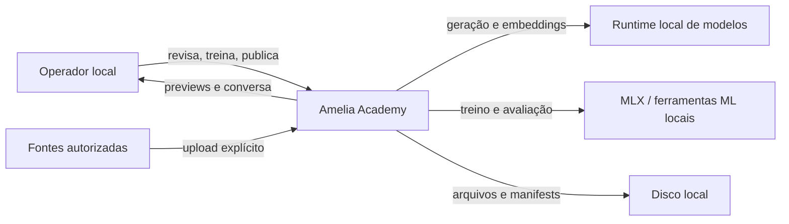
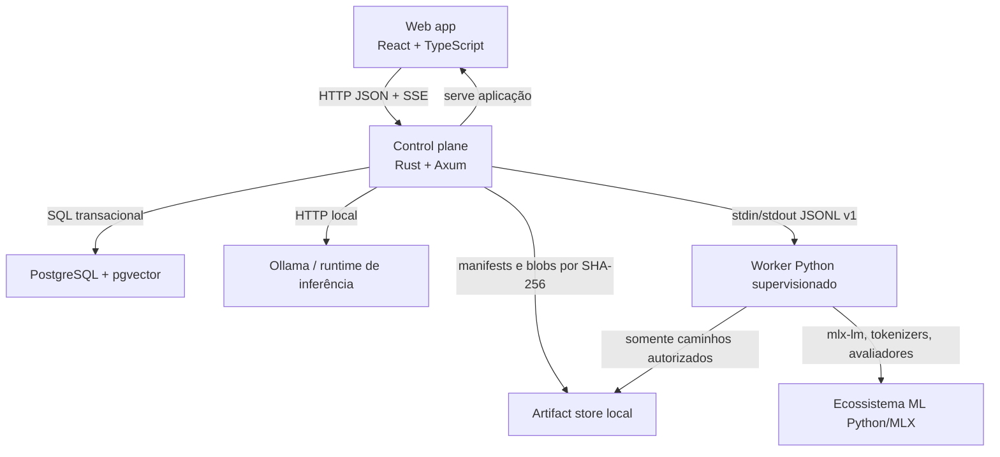

# Amelia Academy — desenho do sistema

**Status:** alvo aceito, ainda não construído  
**Escopo:** arquitetura de longo prazo (Rust, PostgreSQL, workers) e seus contratos com runtimes locais  
**Data:** 24 out. 2026

O que já roda é outra fatia: FastAPI, SQLite e React em `app/`. Fonte de verdade desse fluxo, incluindo o grafo único de conhecimento e comportamento, é [`estado-atual.md`](estado-atual.md). Não trate os diagramas abaixo como o menu nem como o pipeline que a interface mostra hoje.

**Extensão de desenho, ainda não implementada:** ADR 019 e spec 016 propõem confiança determinística da curadoria e perfis direct/reasoned. As menções abaixo a loss somente na resposta final descrevem direct. Reasoned permite loss na justificativa editorial explicitamente aprovada e na resposta final; raciocínio privado continua fora. Contratos e renderizadores precisam ser versionados e verificados antes dessa extensão.

## 1. Contexto e objetivos

Amelia Academy é uma plataforma local-first para transformar fontes autorizadas em temas, fichas de comportamento, samples revisados, datasets, treinos, avaliações e releases reproduzíveis. Amelia é o primeiro projeto, não o produto inteiro. A arquitetura nasce multi-project para evitar que identidade, dados e políticas da Amelia virem pressupostos globais, mas a primeira implantação tem um único operador local e não oferece cadastro público.

O Amelia 3 comprova o valor do portão humano, das fichas ricas, da deduplicação, dos datasets separados dos jobs, do LoRA em MLX e da identidade fora do código. Também mostra os custos que não serão carregados: pipeline psicológico em cascata, cache efêmero como fonte de contexto, templates de chat reimplementados, sincronização opcional com segundo banco e acoplamento entre API, treino e stdout informal.

Objetivos de arquitetura:

- procedência navegável de fonte a release;
- nenhum dado gerado é aceito sem decisão humana explícita;
- controle, autorização, estado e invariantes em Rust;
- ML e ferramentas Python atrás de processos supervisionados e contratos versionados;
- PostgreSQL como sistema de registro, fila, outbox, busca e relações na v1;
- artefatos imutáveis e verificáveis por hash;
- promoção e rollback de uma configuração completa;
- isolamento por projeto desde toda chave, índice e caminho;
- funcionamento sem API paga e sem broker externo.

Ficam fora da v1: colaboração simultânea, autenticação remota, Kubernetes, broker dedicado, graph DB, treino distribuído e ingestão automática de conversa privada.

## 2. Diagramas

### 2.1 Diagrama de contexto



### 2.2 Diagrama de containers



O browser nunca acessa PostgreSQL, Ollama, Python ou o artifact store diretamente. O worker não decide aprovação, autorização, promoção nem estado final de job.

## 3. Organização do monorepo

```text
amelia4/
├── apps/
│   ├── api/                    # binário Axum e composição
│   └── web/                    # React, Academy e conversa
├── crates/
│   ├── domain/                 # tipos, estados e invariantes sem I/O
│   ├── application/            # casos de uso e portas
│   ├── persistence/            # SQLx, transações, queue/outbox
│   ├── artifacts/              # CAS, manifests e verificação
│   ├── worker-protocol/        # envelopes JSONL e compatibilidade
│   ├── inference/              # portas Ollama/MLX/llama.cpp
│   └── telemetry/              # logs, métricas e correlation IDs
├── workers/
│   └── academy_ml/             # pacote Python; sem acesso de domínio ao DB
├── packages/
│   ├── api-client/             # cliente TS gerado do OpenAPI
│   └── ui/                     # componentes compartilhados
├── migrations/                 # migrations SQLx somente forward
├── config/
│   ├── model-templates/        # templates versionados
│   ├── policies/               # gates de plataforma
│   └── projects/               # charters iniciais importáveis
├── fixtures/
│   ├── protocols/              # golden JSONL
│   ├── tokenization/           # token IDs esperados
│   └── evaluations/            # casos sem dados privados
├── docs/
│   ├── architecture/
│   └── adr/
└── var/                        # ignorado pelo git; blobs, logs e exports locais
```

`domain` não depende de Axum, SQLx, Python ou fornecedor de modelo. Adaptadores dependem das portas de `application`; nunca o inverso.

## 4. Contextos delimitados e direção de dependência

| Contexto | Responsabilidade | Não pode fazer |
| --- | --- | --- |
| Projects & Governance | projeto, charter, políticas, ator e auditoria | manipular pesos ou conteúdo de conversa |
| Sources & Themes | arquivos, extração, chunks, direitos, temas e evidência | aprovar samples por inferência |
| Behaviors & Workshop | fichas versionadas, lotes, revisão, hashes e decisões | alterar dataset congelado |
| Datasets | seleção, splits, estatísticas, serialização canônica | aplicar template/tokenização |
| Training | templates, jobs, tentativas, métricas e adapters | promover release |
| Evaluation | suites, runs, casos, resultados e gates | esconder regressões por média |
| Releases | manifest completo, publicação e rollback | mutar artefato publicado |
| Conversation | sessões, mensagens, rota e stream de saída | alimentar Academy implicitamente |
| Platform | fila, outbox, artifacts, protocolo, health e auditoria | conter regra específica de persona |

Direção:

```text
UI → API/application → domain
                 ↘ ports ← persistence/artifacts/inference/worker adapters
```

Referências entre contextos usam IDs estáveis e versões, não acesso às tabelas internas por repositório alheio. Eventos de domínio na outbox integram contextos sem tornar a fila uma segunda fonte de verdade.

## 5. Matriz de ownership Rust/Python

| Capacidade | Rust | Python |
| --- | --- | --- |
| API, autorização, tenancy, validação | dono | nenhum |
| Estado de entidades e jobs | dono e único escritor no PostgreSQL | reporta eventos |
| Upload, hash e caminhos | valida e concede | lê/escreve somente diretório concedido |
| Extração simples de texto | dono (`extractous`) | fallback explícito/OCR futuro |
| Chamada Ollama e geração online | dono | apenas experimento offline autorizado |
| Dataset canônico | seleciona e congela conversas estruturadas | renderiza com tokenizer |
| Tokenizer/chat template | verifica manifest | executa biblioteca oficial e emite fingerprints |
| Treino MLX/LoRA | agenda, supervisiona e registra | executa |
| Avaliação ML | agenda e aplica gates determinísticos | calcula inferências e métricas |
| Artifacts e releases | valida hash, registra e promove | produz candidatos em staging |
| Cancelamento e retries | decide | coopera, faz checkpoint e termina |

Python não recebe credenciais de PostgreSQL. Isso impede que um script marque o próprio job como concluído, promova adapter ou atravesse projetos.

## 6. Protocolos externos

### 6.1 HTTP API

Base: `/api/v1`. Todos os recursos de projeto ficam sob `/projects/{project_id}`. IDs são UUIDv7. Escritas aceitam `Idempotency-Key`; respostas incluem `ETag` e atualizações mutáveis exigem `If-Match`. Erros seguem `application/problem+json` com `type`, `title`, `status`, `code`, `detail`, `correlation_id` e `retryable`.

Operações longas retornam `202 Accepted`:

```json
{
  "job_id": "019a...",
  "status": "queued",
  "events_url": "/api/v1/projects/0199.../jobs/019a.../events"
}
```

Endpoints centrais:

- `POST /projects`, `GET /projects/{id}`;
- `POST /projects/{id}/sources`, `POST .../themes:propose`;
- `POST .../sample-batches`, `POST .../samples/{id}:approve`;
- `POST .../datasets`, `POST .../training-jobs`;
- `POST .../evaluation-runs`;
- `POST .../releases`, `POST .../releases/{id}:publish`, `POST .../releases/{id}:rollback`;
- `POST .../chat/sessions/{session_id}/messages`;
- `POST .../jobs/{job_id}:cancel`.

### 6.2 SSE

`GET .../jobs/{job_id}/events` e o stream de chat usam `text/event-stream`, `id` monotônico por job, `event` estável e `data` JSON. `Last-Event-ID` retoma do `job_events` persistido. Heartbeat é comentário `: keepalive` a cada 15 s.

Eventos de job: `snapshot`, `progress`, `item`, `log`, `artifact`, `completed`, `failed`, `cancelled`. Eventos de chat: `message.started`, `route.selected`, `content.delta`, `citation`, `message.completed`, `message.failed`. Nunca há chain-of-thought bruto. Eventos desconhecidos são ignorados por clientes; campos novos são aditivos dentro da mesma versão.

Exemplo:

```text
id: 42
event: progress
data: {"schema":"academy.sse.job.v1","job_id":"019a...","attempt":1,"current":320,"total":1000,"unit":"steps"}
```

### 6.3 JSONL do worker

Cada linha em stdin/stdout é um objeto JSON UTF-8 terminado por `\n`, limitado a 1 MiB. stderr é log humano e nunca protocolo. O primeiro intercâmbio é `hello`/`ready`; incompatibilidade encerra antes do trabalho.

Comando Rust → worker:

```json
{"schema":"academy.worker.v1","type":"start","request_id":"019a...","job_id":"019b...","attempt":1,"task":"train_mlx_lora","project_id":"0199...","input_manifest":"/grants/in/dataset.json","output_dir":"/grants/out","config":{"seed":42,"epochs":3,"learning_rate":0.00005}}
```

Evento worker → Rust:

```json
{"schema":"academy.worker.v1","type":"progress","request_id":"019a...","seq":17,"phase":"train","current":320,"total":1000,"metrics":{"train_loss":1.82}}
```

Tipos de saída: `ready`, `accepted`, `progress`, `log`, `checkpoint`, `artifact`, `result`, `error`, `cancelled`. Todo evento leva `request_id` e `seq`; `result` contém hashes, tamanhos e manifest candidato. Comandos adicionais: `cancel`, `ping`. O worker responde `error` estruturado (`code`, `message`, `retryable`, `details`) sem traceback no campo público.

O Rust grava a linha antes de produzir efeitos; `seq` duplicado é ignorado. Linha inválida, excesso de tamanho, sequência regressiva ou artifact fora do grant mata a tentativa e marca falha de protocolo.

## 7. Jobs, leases e recuperação

Estados permitidos:

```text
queued → leased → running → succeeded
                    ├──────→ retry_wait → queued
                    ├──────→ cancelling → cancelled
                    └──────→ failed
```

`jobs` guarda `project_id`, tipo, payload versionado, prioridade, status, `attempt`, `max_attempts`, `available_at`, `lease_owner`, `lease_expires_at`, `cancel_requested_at` e erro final. Claim usa `SELECT ... FOR UPDATE SKIP LOCKED`, atualiza lease na mesma transação e emite outbox. Um heartbeat renova a lease a cada 10 s; duração inicial é 30 s.

Retry só ocorre para códigos classificados como transitórios, com backoff exponencial limitado e jitter: 5 s, 30 s, 2 min, 10 min, máximo cinco tentativas por padrão. Erros de validação, licença, protocolo, incompatibilidade e falta permanente de modelo falham sem retry. Cada tentativa tem diretório próprio; resultado parcial nunca ocupa o endereço final.

Cancelamento é cooperativo: API marca `cancel_requested_at`; supervisor envia `cancel`; worker tem 10 s para checkpoint/`cancelled`, depois recebe `SIGTERM` e, após 5 s, `SIGKILL`. O que foi preservado aparece no evento final.

Na inicialização e a cada 15 s, o reaper encontra leases vencidas. Se o PID registrado ainda pertence ao supervisor atual, reconcilia; caso contrário, mata processo órfão identificável, fecha a tentativa como `worker_lost` e reenvia somente jobs idempotentes. Um job de publicação nunca é reexecutado implicitamente; a transação de ponteiro ativo é reconciliada pelo estado do banco.

Queue e outbox compartilham a transação da mudança de domínio. Um dispatcher lê outbox com `SKIP LOCKED`, publica internamente e marca `published_at`. Se um broker for introduzido depois, ele consome essa outbox sem alterar os casos de uso.

## 8. Conversas, datasets e tokenização

A representação canônica é estruturada:

```json
{
  "schema": "academy.conversation.v1",
  "messages": [
    {"role":"system","content":[{"type":"text","text":"..."}]},
    {"role":"user","content":[{"type":"text","text":"..."}]},
    {"role":"assistant","content":[{"type":"text","text":"..."}]}
  ],
  "metadata": {"language":"en-US","behavior_version_id":"019c..."}
}
```

Texto formatado, JSONL específico de framework e token IDs são derivados. O manifest derivado registra hash do dataset canônico, modelo, revisão/tokenizer hash, `chat_template` hash, versões das bibliotecas, flags de thinking, BOS/EOS/PAD, política de loss mask e hashes dos arquivos. Não são adicionados tokens “da Amelia”. Fixtures com token IDs detectam divergência treino/inferência, problema já observado no Amelia 3.

Splits são por cenário/fonte antes de renderizar. A loss cobre apenas conteúdo final do assistant; system, user, tool e reasoning privado são mascarados.

## 9. Artifacts, manifests e releases

Blobs são endereçados por `sha256/<primeiros-2>/<hash>`, gravados em staging, sincronizados, verificados e renomeados atomicamente. Não são alterados no lugar. Metadados mutáveis — nome, estado, retenção — ficam no PostgreSQL.

Tipos: fonte original, texto extraído, dataset canônico, dataset renderizado, tokenizer snapshot permitido, adapter, checkpoint, relatório de avaliação, logs e `ModelRelease`.

Manifest mínimo:

```json
{
  "schema":"academy.model-release.v1",
  "project_id":"0199...",
  "base_model":{"id":"Qwen/Qwen3-0.6B","revision":"commit","sha256":"...","license":"Qwen"},
  "runtime":{"kind":"mlx","version":"...","quantization":"..."},
  "tokenizer":{"sha256":"...","chat_template_sha256":"..."},
  "adapters":[{"role":"persona","artifact_sha256":"..."}],
  "charter":{"version_id":"019c...","sha256":"..."},
  "policies":{"bundle_sha256":"..."},
  "retrieval":{"embedding_model":"...","thresholds":{"min_score":0.72}},
  "evaluations":[{"suite_version_id":"019d...","run_id":"019e..."}]
}
```

O manifest canônico é serializado com chaves ordenadas e sem campos voláteis; seu hash identifica o release. Publicar verifica existência, hash, licença declarada, compatibilidade, gates e isolamento do projeto, então troca `projects.active_release_id` em uma transação e grava auditoria/outbox. Rollback é uma nova publicação de manifest anterior, nunca mutação histórica.

## 10. Persistência, segurança e tenancy

PostgreSQL 16+ com pgvector mantém catálogo, workflow, queue, outbox, auditoria, eventos de job, conversas e, futuramente, memória do Mind. Toda tabela de domínio tem `project_id`; chaves únicas começam por ele; foreign keys incluem ou validam o projeto. Repositórios recebem `ProjectScope` obrigatório. Testes ativam RLS como defesa adicional, mesmo com um só operador.

Segurança local:

- bind em `127.0.0.1` por padrão; proxy remoto exige configuração e autenticação futuras;
- token anti-CSRF para escritas e cookies `SameSite=Strict` quando houver sessão;
- upload limitado por tamanho e MIME detectado; nome original nunca vira caminho;
- worker executa com ambiente mínimo, `cwd` de tentativa, sem segredo de DB e sem shell interpolation;
- grants de arquivo apontam apenas para inputs read-only e output staging;
- logs redigem conteúdo, tokens e caminhos pessoais; payload completo exige modo de diagnóstico explícito;
- fontes registram finalidade e base de uso; exclusão respeita retenção e referências;
- backups são criptografados, verificados por restore e incluem DB mais manifests; blobs podem ser reconstruídos somente quando o manifest declara derivação reproduzível.

O layout físico inclui `var/projects/{project_id}/...`, mas segurança não depende apenas do caminho. O operador local é um ator explícito (`local-operator`) para que auditoria e futura autenticação não exijam reescrever o domínio.

## 11. Implantação local-first

Distribuição inicial: um binário Rust, web assets embutidos, pacote/venv Python bloqueado por lockfile, PostgreSQL local e runtimes locais configuráveis. Um comando de diagnóstico verifica DB, extensões, espaço, Python, MLX, modelos e permissões. O backend inicia mesmo sem runtime ML para permitir leitura e recuperação; ações dependentes ficam bloqueadas com causa específica.

Processos:

```text
academy-api
├── HTTP/SSE
├── queue dispatcher/reaper
└── supervisors
    └── academy-ml-worker por tentativa
```

Não se pressupõe Docker no Apple Silicon, para não perder integração e desempenho do MLX. Containers podem ser oferecidos para API/DB em CI, não como caminho obrigatório de treino local.

## 12. Falhas operacionais

| Falha | Detecção | Resposta e estado preservado |
| --- | --- | --- |
| PostgreSQL indisponível | health/readiness e erro SQL | API fica read-only apenas se snapshot seguro existir; nenhuma escrita é aceita |
| disco cheio | preflight e erro de fsync | tentativa falha; staging é retido/limpo por política; blobs existentes intactos |
| worker trava ou morre | heartbeat/EOF/lease | tentativa `worker_lost`; retry conforme idempotência |
| linha JSONL inválida | parser e limite | mata worker; erro de protocolo sem retry automático |
| SSE desconecta | socket | job continua; cliente retoma por `Last-Event-ID` |
| Ollama/modelo ausente | health específico | ação bloqueada; dados já aprovados continuam acessíveis |
| checksum diverge | verificação antes de commit/load | artifact entra em quarentena e não pode ser publicado |
| template/tokenizer diverge | fingerprint e golden fixture | treino/release bloqueado |
| processo cai após commit | outbox pendente | dispatcher retoma sem duplicar efeito |
| lease expira com processo vivo | PID + owner token | reconcilia ou encerra; nunca dois writers no mesmo attempt |
| cancelamento tardio | flag antes de commit | artifact candidato pode ser preservado, mas job não vira sucesso |
| regressão de avaliação | gate de release | candidato permanece inspecionável, release ativo não muda |
| backup incompleto | restore drill | backup é marcado inválido; anterior continua válido |

## 13. Estratégia de testes

- **Unitários Rust:** máquinas de estado, normalização, hashes, autorização, release gates e classificação de retry.
- **Unitários Python:** renderização, loss mask, parser de config e manifests candidatos.
- **Property-based:** transições de job, idempotência, isolamento por `project_id`, serialização canônica e retomada SSE.
- **Contrato:** golden JSONL em Rust e Python; OpenAPI contra cliente TS; compatibilidade aditiva da versão v1.
- **Integração:** PostgreSQL real com migrations, concorrência `SKIP LOCKED`, lease expiry, outbox e RLS.
- **End-to-end:** fonte → tema → ficha → sample aprovado → dataset → treino simulado → avaliação → release → rollback.
- **ML smoke:** treino mínimo determinístico no Mac suportado; golden token IDs e hash de template.
- **Resiliência:** matar worker/API em cada fronteira transacional, encher staging, desconectar SSE e corromper blob.
- **Segurança:** path traversal, upload poliglota, command injection, vazamento entre projetos e redaction de logs.
- **Migração/restore:** importador Amelia 3 em fixtures anonimizadas e restore completo em diretório limpo.

Fitness functions executadas no CI:

1. `domain` não importa Axum, SQLx ou código Python.
2. Nenhuma tabela de domínio, índice único ou artifact ref existe sem `project_id`, salvo catálogo global documentado.
3. Python não contém DSN nem cliente PostgreSQL.
4. Toda escrita de domínio que exige reação cria outbox na mesma transação.
5. Manifest publicado referencia somente hashes existentes e imutáveis.
6. Nenhum endpoint/UI expõe reasoning bruto.
7. Nenhum dataset inclui mensagem de chat sem `training_consent_id` e revisão.
8. Dataset canônico não contém texto tokenizado como fonte.
9. Fixtures geram os mesmos token IDs em treino e inferência.
10. Um job cancelado/falhado nunca ativa release.

## 14. Entrega e migração a partir do Amelia 3

Não haverá migração direta do schema `amelia_memory`, reutilização de banco, import de módulo Python nem cópia automática de assets. Amelia 3 permanece intacto e somente leitura.

Etapas:

1. **Fundação:** monorepo, API, web, projeto, persona obrigatória, PostgreSQL, queue/outbox, CAS e auditoria.
2. **Academy de conteúdo:** fontes, chunks, temas, fichas versionadas, oficina e aprovação.
3. **Datasets:** conversas canônicas, splits, relatório, renderização no worker e fixtures de tokenização.
4. **Treino:** subprocesso supervisionado, MLX, artifacts, cancelamento e retries.
5. **Avaliação e releases:** gates, manifest completo, publicação e rollback.
6. **Conversa:** release ativo, Ollama/MLX atrás de Rust e SSE sem reasoning bruto.
7. **Mind opcional:** contratos de ledger, workspace, scheduler e policy gate em
   crates separados; API de desenvolvimento opt-in e persistência PostgreSQL
   modelada sem fundir tabelas ou repositórios internos com a Academy.

Importação de referência é uma ferramenta explícita:

- lê exports/arquivos apontados pelo operador, nunca conecta ao DB antigo;
- gera relatório dry-run, hashes, origem `amelia3-reference` e rejeições;
- importa persona como rascunho de charter;
- importa patterns como rascunhos de fichas, preservando campos reconhecidos;
- importa apenas samples aprovados selecionados, sempre para lote de revisão;
- importa datasets/adapters como artifacts legados não publicáveis até rerender, avaliação e manifest;
- não importa sessões, memória ou chats privados por padrão;
- pode ser repetida de modo idempotente pelo hash da origem.

O primeiro release Amelia 4 é reconstruído e avaliado; não é uma continuação implícita do modelo ativo no Amelia 3.

## 14.1 Estado de implementação da referência e do Mind

Implementado neste slice:

- charter Amelia v1 e fixtures curadas Amelia/Atlas sobre as mesmas entidades
  genéricas, acompanhadas por importador HTTP dry-run/apply;
- nenhum acesso ao banco Amelia3, chat privado, memória privada ou pesos;
- crate `memory` com eventos append-only em memória, claims bitemporais,
  evidência, seis ações de claim, tombstones/planos de propagação, open loops e
  retrieval exato filtrado por projeto e sujeito;
- crate `mind` sem executor de modelo, com `Workspace`, `Appraisal`, cinco
  rotas, scheduler determinístico, policy gate, context packet tipado e input de
  compatibilidade de release;
- endpoints opt-in por `ACADEMY_ENABLE_MIND=true`, usando `MindState` em memória
  explicitamente apenas para desenvolvimento;
- migration `0002_memory.sql` para ledger, claims, evidência, tombstones, open
  loops e log de acesso, todos project-scoped e com tempos de mundo/sistema;
- testes de supersession, coexistência contextual, tombstone, isolamento,
  scheduler, gates e inicialização com Mind desabilitado.

Ainda não implementado: repositório SQL do Mind, transações/outbox do Mind,
autorização e políticas RLS de produção, embeddings reais, busca híbrida,
reranker, consolidação/reflexões, execução assíncrona de purge e reconstrução de
projeções, relações SQL/graph projections, runtime de LLM, UI de memória e
compatibilidade efetivamente verificada contra um release carregado. Nenhum
graph DB, embedding real, aprendizado contínuo, consciência ou armazenamento de
chain-of-thought é alegado.

## 15. Decisões, riscos abertos e critérios de aceitação

Decisões aceitas estão detalhadas em `docs/adr/001` a `010`: Rust/Python, queue/outbox, IPC, conversas canônicas, CAS, ModelRelease, multi-project, separação Academy/Mind, PostgreSQL+pgvector e consentimento de treino.

Riscos abertos, sem bloquear o desenho:

- compatibilidade e desempenho reais de modelos/runtimes serão decididos pelo torneio no Mac alvo;
- sandbox forte de processos no macOS exige spike; a v1 depende de grants, usuário local e validação de caminhos;
- limites de tamanho, retenção e quotas serão calibrados com uso real;
- RLS com pool SQLx precisa de teste para impedir vazamento de contexto de conexão;
- reproducibilidade numérica de MLX não é garantida entre versões; por isso versões, seeds, hardware e métricas entram no manifest;
- direitos dos assets e modelos precisam de inventário antes de distribuição;
- protocolo de tools e o Amelia Mind terão ADRs próprios antes de implementação.

Este desenho está aceito quando:

- os dois diagramas renderizam e correspondem aos containers implementados;
- um fluxo completo opera sem broker e sem API paga;
- dois projetos de teste não conseguem referenciar dados ou artifacts um do outro;
- restart em qualquer ponto não perde decisão aprovada nem duplica job;
- cancelamento e worker morto convergem para estado terminal auditável;
- SSE retoma eventos sem reiniciar trabalho;
- dataset canônico é rerenderizado por dois templates sem alterar sua fonte;
- adulteração de blob ou template bloqueia treino/publicação;
- release completo é publicado e revertido atomicamente;
- import dry-run do Amelia 3 não escreve no sistema antigo nem importa chat/memória;
- um chat só aparece no Academy após consentimento, redação e aprovação;
- testes de contrato, isolamento, crash recovery, tokenização e restore passam no CI e no Mac alvo.

## 16. Evidências usadas

- `reports/Psique memória e modelos.md`: Mind como control plane, memória no runtime, PostgreSQL+pgvector, releases completos e separação Academy/Mind.
- `docs/discovery-e-proposta.md`: fluxo fonte→tema→ficha→sample→dataset→treino, Rust/Axum, React, MLX e local-first.
- `docs/brand/*.md`: plataforma multi-project, linhagem, autoria humana, reversibilidade e separação entre voz da Academy e persona.
- Amelia 3: `core/engine.py`, `conditioning_module/training/data_generator.py`, `pattern_manager.py`, `model_training_templates.py`, `memory/unified_memory_manager.py` e planos de dataset/chat template, usados como evidência de valor e de acoplamentos a remover.
